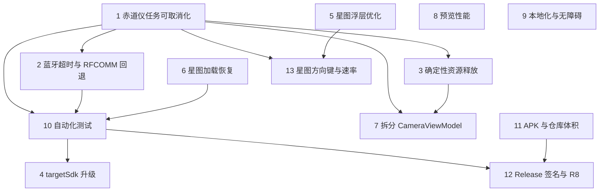

# Mobile Observatory TODO

## P0 产品主线：全应用交互与观测流程（2026-10-13）

核对基线：`main` / `7485d04`。下一阶段产品工作优先完成入口、分类、返回与任务衔接，再扩展新入口；设备安全、崩溃、数据丢失和科学正确性问题仍可先修。2026-10-14 已实施第零批基线和第一批代码，验证记录见 [WF 批次验收](docs/WF_PHASE_0_1_ACCEPTANCE.md)；真人首次找入口、设备/边缘手势等现场验证尚未完成，历史 `[x]` 不代表新流程全部验收。

所有新增/修改界面先遵循 [交互规范](docs/INTERACTION_GUIDELINES.md)，以 [观测流程](docs/OBSERVING_WORKFLOW_DESIGN.md) 为首批实例；[坐标与校准](docs/PHONE_PLATE_SOLVE_PLAN.md)、[设计约定](docs/DESIGN_NOTES.md)约束具体能力。不能用新增“工具”页面或长说明补救分类问题。

### 第零批：共同规范与完整路径原型

- [~] **WF-00 · P0 · 建立交互基线。** IG-01–IG-10 规范、四工作区编排及典型路径预算已写入文档。已补全 40 项入口/返回/状态清单与可操作离线原型（18 条 DOM 路径走查通过），真人首次找入口测试待做；每个入口记录唯一归属、前置条件、回到哪里和状态是否保留。设计/代码/真机分别记状态，文档完成不算交互改造完成。验收 UX-11/12。

### 第一批：P0 入口、层级与日常操作

- [~] **WF-01 · P0 · 四工作区与观测任务合流。** 任务归属为星图/拍摄/影像/器材，按用户 2026-10-14 追加要求恢复一级工具快捷页，允许入口冗余但共用任务和状态。保留主题、自适应布局和拍摄起始页。赤道仪完整控制归器材，常用控制就近可达；星图共用搜索/目标库/推荐与推镜/GOTO；极轴和指向校准归观测准备；影像提供最近拍摄与按素材处理。共享目标、光路、任务及来源，不改写运行中目标；补齐无 Stellarium 路径。验收 UX-01/09/10/11/12，校准依赖按后续批次验收。
- [~] **WF-02 · P0 · 设备状态就地操作。** 顶部状态带保留；点滤镜轮/调焦器等一次打开对应设备快捷控制，未连接时打开定向连接，完成后继续原任务。完整器材页清单→详情，不叠第二排全设备导航；快捷与详情共用状态/组件及具体设备身份。验收 UX-02/05/12。
- [~] **WF-03 · P0 · 统一返回栈。** 系统边缘手势、三键返回、工具栏返回按输入法/最上层浮层/全屏模式/步骤/子页逐层处理，移除星图返回硬编码到赤道仪。起始根页才由系统退出，工具栏 Up 不退出；外部文件按平台 Back/Up 例外处理，取消预测性返回不改变状态。覆盖完整页、sheet、设置、播放器和旋转恢复，返回不暗中断线/丢结果。验收 UX-03/05/10/13。
- [~] **WF-04 · P0 · 星图空白与面板交互。** 分离目标与卡片可见性；空白短按立即隐藏普通控件及卡片/面板，再点空白唤回，保留目标/任务且不穿透、不重弹卡片。内部点击、拖动、缩放和边缘返回正确区分；左下角小锁暂停超时隐藏、解锁重新计时，锁定不阻止主动关闭，STOP 始终可达。验收 UX-04/10/13，现场验证继续待办。
- [~] **WF-12 · P0 · 通用交互复用与全应用巡检。** 将关闭/返回、编辑保存、就地设备控制、任务摘要与恢复、空/忙/失败状态收敛到共享规则和适当组件；按 IG-01–IG-10 检查相机/EAA/后处理/影像/器材/设置，按具体任务记录缺口。复用不要求一次重写所有界面；典型路径先完成，其他入口逐项迁移。验收 UX-09–13。

第一批已落地：四工作区与原生目标库、设备快捷 sheet/清单详情、每页独立返回来源、目标与卡片分离、最近素材分类、预览/大图返回、草稿覆盖保留、隐藏播放器/手机引导暂停。共享候选目标不改写正在采集的命名/任务。第一批结果见 [验收记录](docs/WF_PHASE_0_1_ACCEPTANCE.md)；随后真实标定、设置草稿和来源合流的本轮实现与验证见 [剩余批次账本](docs/WF_REMAINING_IMPLEMENTATION.md)。未获得的真人/真机证据继续保留待办，不按代码存在提前勾选。

2026-10-14：剩余批次已开始实施，真实状态与未闭合项见 [剩余批次实施账本](docs/WF_REMAINING_IMPLEMENTATION.md)。S23 Ultra 报告的相机／制冷入口崩溃已在模拟器复现并修复，同三项回归通过；真机复核仍待进行。

2026-10-16 拍摄页紧凑化：代码已移除第二顶栏和右侧重复实时叠加入口，目标/格式合并为单行紧凑底栏，全局状态带降低高度；预览菜单完成目标、当前帧解析和 LP700 预览映射迁移，并移除全局夜视、文件浏览和普通离线解析的重复入口。当前帧解析会先补齐焦距、截取临时 FITS、自动进入完整结果页。自动化与模拟器布局验证完成后更新本项，横屏小屏、200% 字体和真实相机解析仍需真机验收。

### 第二批：可信坐标、真实标定与引导

- [~] **WF-05 · P1 · 坐标、来源与能力契约。** 分开手机画面姿态、镜筒轴、架台模型回读、目标坐标和当前估计；记录历元/单位、曝光中点、物理镜头/光路身份、内参/裁切/奇偶性、关系版本、质量和时效。架台读取/GOTO/SYNC/跟踪/轴运动观测分别建模；不按 L1–L5 固定升档，不把刚 SYNC 后的回读算作独立参考。需含源切换、时钟/历元、错误角色和模型变更测试。
- [~] **WF-06 · P1 · 指向相机与主镜校准闭环。** 依赖 WF-05。真实采样、非同轴关系与独立验证已有；2026-10-14 追加将手机具体摄像头/辅助（导星）相机合并为同一任务，主镜参考统一选择目镜亮星居中/主镜相机，无架台均可完成。安装明确固定/可调后锁紧/无法固定；可选同轴调整显示真实配对偏角和光学坐标分量，调后关系失效且粗调样本不作为标定训练。固定不同轴可直接采样，无法固定不保存关系；结果明确相机→主镜、安装、轴向/含转角和独立验证误差。保存按移位/换镜头/设备/光路变化局部失效，失败不覆盖有效结果，镜面 hand-eye 约束继续保留。见 [统一校准设计与 PC-01–09 账本](docs/POINTING_CAMERA_CALIBRATION_DESIGN.md)，验收 UX-06/08；本次合并实现与现场证据分别记录。
- [~] **WF-07 · P1 · 推镜必须验证本次到位。** 依赖 WF-05/06。完整姿态与相对传播接入统一会话；修正球面角距，处理慢推、微调、停手冷却定时重试、曝光中运动、异步过期结果及失败退避。旧板解或 IMU 预测不能跳过本次移动后的独立验证；容差结合视场和总误差，静止 Dob 仍更新时间与天球方向。验收 UX-07 和低速/小位移状态机回归。
- [~] **WF-09 · P1 · 视场与指向来源一致。** 依赖 WF-05/06，与 WF-07 合流。主镜/导星独立配置和位置角保留；当前框使用该光路的有效估计并标明来源/年龄；无可信来源时仅显示明确的构图预览。手机中心、架台回读和主镜方向不能默认相等。目标框钉目标坐标，无目标时标作构图。验收 UX-08。

2026-10-14 统一校准追加：同一页面/Task 已接入手机具体镜头和辅助设备选择、目镜/主镜参考、三种支架状态、真实粗调测量、独立验证及保存；高级与坐标详情默认折叠。保存来源/镜头带回实际推镜，已选镜头不可用时不自动换镜头。PC-01–07 已接入并通过对应自动化检查（986 项 JVM；模拟器合并 44 通过、1 项按模式跳过），测试/标准 APK/PR 的实际证据在 [统一校准账本](docs/POINTING_CAMERA_CALIBRATION_DESIGN.md) 追加，PC-09 夜间/真实器材验收继续单列。

### 第三批：电动辅助与完整验收

- [~] **WF-08 · P1 · 参考相机、GOTO、SYNC 与轴读数合流。** 依赖 WF-05/06/07。复用现有精确居中与 `MountMotionRunner`；正确选择参考光路并协调采集所有权。支持只读、可 GOTO 无 SYNC、可 SYNC、可观测手动轴运动等组合；自动采样说明运动/写回行为并可 STOP。核实 AZ-EQ6 等实际协议的辅助编码器能力，不按型号推断；SYNC/零位切换隔离旧轴增量。独立光学验证写回效果，单点同步不冒充全局自动对齐。验收 UX-05/06/10。
- [~] **WF-10 · P2 · 实拍与资源基线。** 持久化宽场索引、按需加载、机型兼容、能耗及采集并发按解算计划继续推进。立即开始实拍基线，不以索引优化为前提；记录 ≥30 组独立参考 WCS、误解率、镜筒验证残差、P95 耗时、状态耗电、温度和对主相机/导星的影响。息屏语音与低功耗唤醒单列实验，未验证不宣传精度/续航保证。
- [ ] **WF-11 · P0 · 每批交互验收与完整新手流程。** UX-01–UX-13 随批次验证；第一批先覆盖可独立完成的入口/控制/返回/找回结果，UX-06–08 待真实校准依赖完成，不能提前勾选。至少两名未参与开发的新手不经入口讲解，完成找推镜/配件/校准/素材，再随功能完成验证目视或 EAA 全链路。记录首次入口、点击次数、绕行、意外退出、丢状态和求助；自动化、原型与真机证据分开，小样本不作总体成功率承诺。

实施顺序：WF-00 → WF-03/04 与 WF-02 的短路径 → WF-01/12 分类迁移和全应用巡检；WF-11 每批参与完成判断。随后 WF-05 → WF-06 → WF-07/09 → WF-08；WF-10 可独立持续。不得因手机算法尚未成熟而推迟返回/设备控制修复，也不得为交付入口显示虚假的校准结果。

## 相机色彩与 SER CFA（2026-10-14）

- [x] 可见光不再默认应用 LP700；大图显示降采样与软件 bin 保留 CFA 相位，预览/MP4 使用明确位深和对齐，单次 AWB 同帧应用。见 [色彩修复](docs/CAMERA_COLOR_AND_SER_CFA.md)。
- [x] SER/PSER 后处理可选自动、单色、RGGB、BGGR、GRBG、GBRG；保留 DDFAPD/VNG/双线性，重读/重分析、导出来源和校准有效排列兼容性一起更新，输入原文件不改写。
- [ ] AE676C 在同一色卡、光源、曝光/增益/HCG 与白平衡条件下复拍；不能用模拟器合成样本代替真机颜色标定。
- [ ] 2026-10-15：LP700 银心主体偏红、与电脑显示不一致；等待同一原始 FITS、电脑端公式/参数和参考图建立实图回归，处理入口与取证缺口见 [色彩修复](docs/CAMERA_COLOR_AND_SER_CFA.md)。本轮署名和主页链接修正独立验收，颜色矩阵及白平衡保持原值。

## 相册单张图像编辑（2026-10-25）

- [~] 影像查看页接入单张后期：LP700、自动/手动白平衡、亮度 EV、黑白场和伽马曲线；按原始分辨率另存 JPG/PNG/Float32 FIT，彩色 Bayer/RGB 输出 RGB 三平面。包含原片保护、处理参数记录、保存后查看、未保存提示和旋转任务保持。预发布版本为 v1.0.9 / build 50；编译及自动化记录见 [相册编辑](docs/ALBUM_IMAGE_EDITING.md)，设备验收和正式发布继续待办。

## 深空与行星叠加

- [x] 2026-10-14 用户补充的代码及自动化验收：实时/后期两个入口各自支持行星与深空顶部标签；影像导入与后期叠加分开；拍摄「…」提供显式 CFA 套用。横屏、模拟地景/罗盘浏览、统一隐藏及更多面板操作保护同批交付，删除重复夜视入口；构建/回归与测试 APK 见 [更新记录](docs/STACKING_AND_SKY_INTERACTION_UPDATE.md)。现场验收按用户选择稍后进行，不计入本项完成。
- 2026-10-14 追加复核：对照已发布 v1.0.7 检查旧入口，按用户要求恢复工具标签/页面，并保留工作区内的解析与 D20/D50 离线库路径，见 [发布版入口审查](docs/FEATURE_ENTRY_AUDIT.md)。星图空白立即隐藏、小锁、红色短地点按钮与此修复统一交付；不将尚缺的现场证据标为完成。

- [x] 新手素材库、保存后直接查看、EAA 一次自动拉伸/大图观测、采集暂停与工作区返回衔接；见 `docs/STACKING_USABILITY.md`。
- [ ] 邀请实际新手完成连接、对焦、EAA、保存及找回结果的完整操作验证。

- [x] 深空实时叠加与行星后处理完整实现及 APK 验收：599 项 JVM、6 项 Android 测试通过，标准 ARM64 APK 已生成；真机与实拍验收另列。见 `docs/STACKING_IMPLEMENTATION.md`。
- [x] 原始线性高位深读取、Bayer/ROI 相位、SER/PSER/RGB 与大文件偏移、浮点 FITS 独立读回。
- [x] 星点平移/旋转、逐像素权重、在线异常抑制；行星质量分析、全局/多点配准及接缝/双边缘测试。
- [x] 可逆三种处理状态、背景屏蔽与渐变模型、可重现参数、真实文件端到端合成测试。
- [ ] 真机长时验收：记录设备型号、实际分辨率/FPS、Java/native 峰值内存、录像并行队列丢帧、USB 拔插与温升。
- [ ] 实拍验收：经纬仪视场旋转、云层/拖线、暗弱星云/星系外延、木星/土星环/月面视宁度序列。
- [x] 可选 BIAS/DARK/FLAT 校准库、传感器域校准与三步拍摄引导；支持 SER/PSER 建主帧，参数兼容性校验、取消清理、持久化和导出溯源。见 `docs/STACKING_CALIBRATION.md`。
- [x] 默认自动 GC、手动打点 DBE、选点放大微调、保护框和可重现配方；维持现有暗色/红光主题与分层入口。
- [ ] 校准主帧 FITS 导入/导出、暗平场、坏点掩膜及稳健主帧合成；当前为受限内存的算术平均主帧。
- [ ] 支持有完整曝光来源元数据的工业软件长曝光合成；当前超硬件曝光合成明确拒绝进入实时叠加。
- [ ] Drizzle、行星自转校正、复杂反卷积、批量调度和更多视频格式。

## WandererAstro / Oasis accessories

- [~] WandererRotator Mini / Lite V1 / Lite V2: USB-serial **code** landed; hardware acceptance open. See `docs/wanderer-support-plan.md`.
- [ ] WandererCover V3 / V4-EC / V4 Pro-EC: cover and flat-panel support.
- [ ] Wanderer Snowflake filter wheel: serial protocol adapter.
- [ ] WandererBox Plus V3 / Pro V3: power, USB, PWM and environment controller.
- [~] Oasis USB HID: Rose 二代电调焦已真机通过；一代电调焦与两款滤镜轮待测。见 `docs/OASIS_ACCESSORY_INTEGRATION_PLAN.md`。

> 本轮交互主线按上方明确批次执行；其余事项的优先级表示风险与收益，具体顺序结合依赖安排。
>
> 状态约定：`[ ]` 待办、`[~]` 进行中、`[x]` 已完成、`[-]` 暂不实施。

## 决策区

下一阶段产品优先顺序如下；设备安全、崩溃、数据丢失和科学正确性修复可先行：

| 顺序 | 事项 | 决策/备注 |
|---:|---|---|
| 1 | WF-00 | 规范、入口清单和原型已建立；真人首次找入口验证待做 |
| 2 | WF-03/04、WF-02 | 代码已落地；按验收记录完成模拟器/真机与手势验证 |
| 3 | WF-01/12 | 四工作区、目标/影像已合流；继续复杂编辑器与现场交互验收 |
| 4 | WF-05 → WF-06/07/09 → WF-08 | 按既有规范增加真实标定和电动辅助，不再各自搭入口 |
| 持续 | WF-11、WF-10 | 每批交互验收，实拍/性能独立采集；不等最终版本才找新手测试 |

---

## P0：设备安全与连接可靠性

### [x] 1. 赤道仪任务可取消化与安全停止

**涉及模块**

- `MountMotionRunner` 统一运动生命周期
- `CameraViewModel` 中的 GOTO、回零、定距 RA、手动移动和断开流程
- `Lx200MountController` 的协议级全轴停止
- `CameraScreen` 全局 STOP 控件

**已完成**

- 建立结构化 `MountMotionState`，同一时间只允许一个活动运动。
- 星图 GOTO、回零、定距 RA 和手动移动全部接入统一 runner。
- 用户停止时先取消本地任务，并立即在不可取消上下文中发送协议级全轴停止。
- 运动异常会自动尝试全轴停止，正常完成不会误发停止命令。
- 断开赤道仪前会先停止活动运动；应用销毁时会在关闭 transport 前尽力停止。
- GOTO / 回零 / 定距 RA 期间在所有应用页面持续显示醒目的全局 STOP 按钮，并显示 STOPPING 状态。手动方向键不弹全局 STOP，避免与方向盘重叠导致断触。
- 运动期间拒绝启动第二个冲突动作；方向键松手不会误停一个被拒绝的 GOTO。
- 星图 GOTO 使用坐标轮询和球面角距离判断到达目标，连续两次进入 0.05° 容差后结束。
- 回零使用坐标稳定性检测，并为 GOTO/回零设置 5 分钟超时。

**验收结果**

- [x] 定距移动可立即停止，停止后不会更新为“完成”。
- [x] 星图 GOTO 和回零全过程都有 STOP 按钮。
- [x] STOP 在 GOTO / 回零 / 定距移动期间于各页面持续可见；手动方向键不弹全局 STOP。
- [x] 断开连接会取消活动运动并发送停止命令。
- [x] 取消和异常路径会尽最大努力发送一次全轴停止命令。
- [x] 不会同时运行两个互相冲突的运动命令。
- [x] 自动化测试覆盖停止、异常、并发拒绝和正常完成路径。
- [ ] 使用真实 OnStep、iOptron 和 SkyWatcher 赤道仪验证 GOTO 完成容差与停止响应。
- [x] 真机确认不同页面及 WebView 上方的全局 STOP 按钮触控正常。

**风险/成本：** 已完成；仍需多协议真机验证。

---

### [x] 2. OnStep 蓝牙连接超时与 RFCOMM 兼容回退

**涉及模块**

- `Lx200MountController.connectBluetooth()`
- Bluetooth transport adapter
- 赤道仪连接状态 UI

**现状**

- 当前只使用 `createRfcommSocketToServiceRecord(SPP_UUID)`。
- `BluetoothSocket.connect()` 没有明确、可展示的应用层超时。
- 部分 HC-05、HC-06 或 OnStep 蓝牙模块可能只兼容 insecure RFCOMM。
- 连接中缺少取消入口和分阶段状态。

**建议**

- 为蓝牙连接增加 10～15 秒超时。
- 首次连接失败后尝试 `createInsecureRfcommSocketToServiceRecord()`。
- 如确有设备需要，再评估反射创建 RFCOMM channel 1；默认不要依赖反射。
- 取消或超时时主动关闭正在连接的 socket。
- UI 显示“标准模式连接中”“正在尝试兼容模式”“已取消”“连接超时”。
- 记录各连接阶段和错误原因，但不要记录敏感设备信息之外的数据。

**验收标准**

- [x] 无响应设备不会导致连接界面长期卡住。
- [x] 用户可取消正在进行的连接。
- [x] 标准 RFCOMM 失败后可自动尝试 insecure RFCOMM。
- [x] 成功、超时、权限拒绝、蓝牙关闭和未配对设备有不同提示。
- [ ] 使用至少一个真实 OnStep 蓝牙模块完成连接与坐标读取验证。

**依赖：** 建议与“赤道仪任务可取消化”一起设计。

**风险/成本：** 中。

---

### [x] 3. 应用销毁时确定性释放设备资源

**涉及模块**

- `CameraViewModel.onCleared()`
- 相机、赤道仪、导星和配件 manager/controller

**原问题**

- `onCleared()` 内通过即将取消的 `viewModelScope` 启动异步断开，无法保证完成。
- 多个显式 Job、writer 和设备连接缺少统一关闭顺序。

**已完成**

- 统一取消全部 ViewModel 子任务和显式持有的后台任务。
- 同步结束录制线程并关闭 SER、PSER、MP4 writer。
- 同步注销广播并关闭所有设备 manager/controller 和 transport。
- 提供按顺序、异常隔离且幂等的统一清理器。

**验收结果**

- [x] 销毁时取消全部子任务及显式 Job。
- [x] 录制线程结束，所有 writer 同步关闭。
- [x] 相机、导星相机、配件及赤道仪 transport 同步关闭。
- [x] 重复执行清理不会重复释放，单步失败不会阻止后续步骤。
- [x] 自动化测试覆盖清理顺序、异常隔离和幂等性。
- [ ] 真机确认 Activity 重建后各设备可以正常重连。

**实现说明**

- 关闭顺序为：取消 ViewModel 子任务和显式 Job → 注销自有广播 → 结束录制线程并关闭 writer → 关闭相机、导星相机、配件和赤道仪 transport。
- `Lx200MountController.close()` 是同步、幂等的生命周期终止接口，不依赖 `viewModelScope`；正常业务断开仍使用 suspend `disconnect()`。
- 销毁时不再启动 MP4 图库复制任务，避免依赖即将取消的 scope；录制原文件仍保留在应用目录。
- 正在建立的 TCP、USB 或蓝牙连接从创建起即归 controller 所有，销毁可关闭底层资源解除阻塞。

**风险/成本：** 已完成；仍需真机验证 Activity 重建和厂商 SDK 重连。

---

## P1：Android 兼容性与星图体验

### [ ] 4. 分阶段升级 `targetSdk`

**涉及模块**

- `app/build.gradle.kts`
- Android Manifest 和运行时权限流程
- 厂商相机 SDK、文件存储、WebView 和蓝牙

**现状**

- `compileSdk = 34`，但 `targetSdk = 28`。
- lint 禁用了 `ExpiredTargetSdkVersion`。
- 现代 Android 对蓝牙、存储、通知、WebView 和后台行为的规则与 API 28 差异较大。

**建议**

- 不要只修改版本号；按 API 29、31、33、34/35 的行为变化建立迁移清单。
- 重点验证 Scoped Storage、附近设备权限、USB、WebView、前后台切换和厂商 native SDK。
- 移除过期权限与 lint 豁免。
- 建立 Android 12～15 真机/模拟器兼容测试矩阵。

**验收标准**

- [ ] 目标 API 达到计划发布渠道的最新要求。
- [ ] Android 12、13、14、15 上完成相机、赤道仪、文件保存和星图冒烟测试。
- [ ] 不再禁用 `ExpiredTargetSdkVersion`。
- [ ] 权限拒绝和“不要再询问”状态有清晰恢复指引。
- [ ] 旧 Android 最低版本仍符合 `minSdk` 约束。

**风险/成本：** 中高；需要重点验证第三方相机 SDK。

---

### [x] 5. 星图浮层自动收起与进一步紧凑化

此项保留原自动收起范围的实现记录。后续 WF-03/04 已接入空白点击关闭、目标卡可见性和逐层返回，并有两种构建的自动化回归；现场验收仍待完成，见 [剩余批次账本](docs/WF_REMAINING_IMPLEMENTATION.md)。本项 `[x]` 不代表整个交互验收完成。

**涉及模块**

- `StarMapScreen`
- Stellarium WebView 覆盖层

**已完成**

- 目标卡片默认仅显示目标名和 GOTO；点击目标名展开坐标与连接提示。
- 大气开关与“锁定浮层”收进右上角设置菜单。
- Ready 状态下空闲约 4 秒后淡出非必要浮层；点空白立即隐藏，再点唤回，选择目标后重新显示。
- 返回按钮保留可访问名称；主动返回和恢复现已按 WF-03/04 接入统一壳层与面板关闭规则，现场状态另见 WF 验收账本。
- 左下角提供小锁，固定显示控件或恢复自动隐藏；仍允许空白主动隐藏，唤回后保持锁定选择。

**验收结果**

- [x] 无目标时非必要控件可自动收起。
- [x] 有目标时默认单行紧凑布局（名称 + GOTO）。
- [x] 浮层隐藏后可通过点击星图恢复。
- [ ] 横屏不同分辨率下真机确认无控件重叠或越界。
- [x] 返回、设置和 GOTO 具备可访问名称。

**风险/成本：** 低中；多分辨率真机布局仍需确认。

---

### [x] 6. 星图 WebView 加载失败、超时与崩溃恢复

**涉及模块**

- `StarMapScreen`
- `StarMapLoadRules`
- Stellarium asset loader

**已完成**

- 处理主框架 `onReceivedError()`、HTTP 错误和 `onRenderProcessGone()`。
- 引擎启动超时 45 秒，超时后进入可重试错误态。
- 错误卡片提供“重新加载星图”；重试前销毁旧 WebView/JS bridge 并递增 session。
- 抽取 `StarMapLoadRules` 覆盖 ready/failure/timeout 状态迁移，并补充单元测试。
- Ready 后的迟到失败不会覆盖已就绪状态。

**验收结果**

- [x] 资源缺失、损坏或加载超时时显示可理解的错误与重试入口。
- [x] 用户可以原地重试，无需重启应用。
- [x] renderer 崩溃后进入错误态并可重新加载。
- [x] 重试通过 session key 重建 WebView，避免重复 bridge。
- [x] 有加载成功、失败、超时状态迁移单元测试。
- [ ] 真机验证资源缺失与超时路径的实际提示文案。

**风险/成本：** 中；真机 WebView/资源路径仍需确认。

---

### [x] 6b. 星图闭环「指向并居中」（解析 → 同步 → 再 GOTO）

**涉及模块**

- `MountModule.startPrecisionGoto` / `PrecisionGotoMath`
- `CameraViewModel.captureAndSolveForPrecisionGoto`
- 星图「指向并居中」按钮与进度文案

**已完成**

- 选中天体后可启动「指向并居中」：GOTO → 等帧拍照 → ASTAP 解析 → 星图居中到解算坐标 → 误差大于停止阈值则 sync（或 SkyWatcher 纠偏 GOTO）→ 再对准，最多 5 轮。
- 目标、解算、sync、星图居中统一到 JNOW；ASTAP J2000 先岁差再比较。
- 默认停止误差 **6′**，星图观测工具可改（`star_map_precision_tolerance_arcmin`，1′–30′）。成功当轮若支持 sync 仍会写入解算位置。
- 目视「同步」与单次 GOTO 仍保留；「视场居中 / 居中到赤道仪」收到展开详情里，默认只显示目标名 + 指向并居中 + GOTO。

**验收标准**

- [x] 单元测试覆盖角距、纠偏、JNOW/J2000 混用与 6′ 默认容差。
- [ ] OnStep / iOptron 真机：指向并居中收敛到设定误差。
- [ ] SkyWatcher：无 sync 时纠偏路径可用。
- [ ] 相机未连接或未装 D50 时有明确提示。

**风险/成本：** 依赖曝光/星库/焦长提示；长曝光时需等新帧。

---

### [~] 6c. 星图显示相机 / 目镜视野范围

**涉及模块**

- `StarMapScreen` 视野设置入口
- Stellarium `MercStarMap` / `fov-current` / `fov-target`
- 相机焦长、像素尺寸、ROI；目镜焦距与视场角

**已完成（首版 + M1a 双光路）**

- 「跟随赤道仪」可选：默认关闭，拖动画布暂停跟随；需要时再开跟随或「居中到赤道仪」。屏幕中心十字丝已去掉。
- 主镜 / 导星两条光路独立配置；选中目标时黄虚线钉在目标天空坐标，未选目标时使用屏幕中央构图。本轮 WF-09 将当前框与跟随接入该光路的有效光学来源；架台回读保留为诊断，不能代替镜筒轴。最新验证见剩余批次账本。
- 观测工具面板切换光路；视场设置顶栏同样可选要编辑的光路，改副光路不必切显示。
- 已连接相机可挂到任一条光路。旧 `star_map_*` 键迁到主镜；默认显示导星。
- 板解焦距只在导星且为相机时，从视场设置写入。决策见 `docs/DESIGN_NOTES.md` 与 [`docs/STAR_MAP_DUAL_FOV_PLAN.md`](docs/STAR_MAP_DUAL_FOV_PLAN.md)。

**仍待**

- 目镜预设库。
- WF-09 的可信当前框/构图区分，以及主镜、辅助光路与手机标定关系接入。

**验收标准**

- [x] 可跟随赤道仪指向；默认不跟随，拖动即暂停。
- [x] 目镜模式：输入视场角后显示圆形范围。
- [x] 相机模式：按宽高角径显示矩形范围。
- [x] 可从已连接相机 + 焦距自动估算 FOV（缺焦距时手填）。
- [x] 主镜 / 导星独立配置，切换后只显示一条光路。
- [x] 不跟随时当前框可钉在赤道仪天空坐标上；目标框可投影到选中目标，无目标时提供中心构图。

**风险/成本：** 低；自动估算依赖厂商上报的 `pixelSizeUm` 与用户填写的焦距。

---

### [x] 13. 星图方向键面板与更细粒度移动速率

**涉及模块**

- `StarMapScreen` 浮层控件
- `MountModule` / `CameraViewModel` 手动移动与停止入口
- `MountSlewRate` 与各协议 adapter（OnStep/LX200、iOptron、SkyWatcher）
- `MountControlScreen` / `ControlPanel` 现有速率选择 UI

**已完成**

- 星图左下角增加方向按钮；赤道仪未连接时灰色禁用，已连接后可展开紧凑方向面板。
- 面板提供北/南/东/西（按住移动、松手停止）与停止按钮，复用 `MountMotionRunner` 手动移动路径。
- 方向面板展开期间不自动收起浮层；断开连接时自动收起面板。
- `MountSlewRate` 扩展为 OnStep `:R0#`…`:R9#` 十档（0.25×…Max），导星仍走 1×（原 `:RG#`）。
- iOptron 映射到 `:SR1#`…`:SR9#`，SkyWatcher 映射到 fixed-rate 0…9；旧 Guide/Center/Move/Slew 偏好可迁移。
- 星图、赤道仪页与相机控制面板共用同一 `mountSlewRate` 状态，速率 Chip 改为横向滚动。

**验收结果**

- [x] 星图有方向按钮；未连接时灰色禁用，已连接时可打开方向面板。
- [x] 方向面板可控制北/南/东/西移动，并提供停止；复用事项 1 的手动移动冲突拒绝逻辑。
- [x] 移动速率支持 OnStep `0.25×…Max` 十档；iOptron/SkyWatcher 有明确映射。
- [x] 星图、赤道仪页与相机控制面板的速率选择保持同步。
- [x] 方向与速率入口具备可访问名称；有 `MountSlewRate` 单元测试。
- [ ] 真机用 OnStep 验证各档移动手感与小屏横屏布局。

**风险/成本：** 代码已完成；多协议手感与小屏布局仍需真机确认。

---

### [x] 14b. SN 锁定构建迁入本仓库

**已完成**

- 从 merc `BuildLocked.ps1` 迁入 Android-only 版本：`BuildLocked.ps1`
- 临时写入 `License.kt` 哈希 → `assembleDebug` → 输出 `bin/Installer/IndigoObservatory_<SN>_android.apk` → 还原源码
- `AGENTS.md` 补充用法；工业机打开路径沿用现有 `License.checkSerial`

**验收标准**

- [x] 开发树默认 `arrayOf()` 解锁。
- [ ] 用真实大恒 SN 打锁定包并验证未授权 SN 无法打开。

---

### [x] 14. 三点极轴校准对齐 NINA TPPA

**涉及模块**

- 新增 `astro` 包：`AstroTime`、`Precession`、`Nutation`、`Refraction`、`CoordinateTransform`、`AstroMath`
- `polar`：`PolarAlignmentCalculator`（重写为 `PolarErrorDetermination`）、`PolarVector3`、`ContinuousPolarErrorEstimator`
- `astrometry`：`FitsHeaderReader`（曝光中点）、`FitsWcsParser`
- `recording/FITSWriter`：`DATE-OBS` 改为曝光开始时刻
- `PolarAlignmentScreen` 工作流与结果展示

**已完成**

- 建立完整视位置归算链：ICRS/J2000 → 岁差章动（IAU 2006/1980）→ 周年与周日光行差 → GAST → 地平坐标 → 蒙气差，
  并实现反向变换。此前直接把 ASTAP 的 J2000 结果当成当日视位置使用，系统偏差可达数十角秒。
- 蒙气差移植 SOFA `iauRefco` 与 Green 模型，支持气压、温度、湿度和波长；海拔缺省用标准大气压推算。
- `PolarErrorDetermination` 对齐 NINA：真极/折射极两种参考、赤纬跨度过小警告、初始误差过大警告、
  修正视场靠近正东/正西的警告，以及修正目标坐标。
- 移植 `ContinuousPolarErrorEstimator`：阻尼高斯-牛顿求解实时残差，调整过程中持续给出当前误差而不是镜像放大。
- 工作流对齐：手动模式等待用户确认再拍下一点、自动模式等待赤道仪运动结束、移动不足告警、稳定延时、
  容差内连续两次确认后自动完成。
- 曝光时刻改为从 FITS 头 `DATE-OBS` + `EXPOSURE` 取中点。此前手动载入的图像会按打开时刻计算，每秒偏差 15 角秒。
- 单元测试：`CoordinateTransformTest` 用 ERFA `atco13`/`atoc13` 基准把变换钉在 1 角秒内；
  `PolarErrorDeterminationTest` 复用 NINA 的 Astropy 参考值；`ContinuousPolarErrorEstimatorTest` 复刻 NINA 的南北半球回归用例。

**验收结果**

- [x] 变换链与 ERFA 基准在 1 角秒内一致（含真极与折射极两种模式）。
- [x] 三点解算结果与 NINA/Astropy 参考值一致，且与三点先后顺序无关。
- [x] 实时残差估算在南北半球都能收敛到 0.1 角秒内，物理改善时读数变小。
- [x] 曝光时刻取自 FITS 头，手动载入历史图像不再引入时间误差。
- [ ] 真机整套流程验证：自动/手动模式、连续修正、容差自动完成。

**风险/成本：** 代码与测试已完成；实拍链路（相机曝光、赤道仪转动、解析耗时）仍需真机验证。

---

### [x] 15. libusb Android FD patch 入库 + 导星最小修正量 UI

**已完成**

- 将 submodule 内对 `linux_usbfs.c` 的 Android fd 改动导出为 `patches/libusb-android-fd.patch`。
- `Build.ps1` / `BuildLocked.ps1` / Gradle `applyLibusbAndroidFdPatch` 在原生编译前幂等应用；`AGENTS.md` 已说明。
- 导星最小修正量滑条上限从 5 px 改为 1 px，默认 0.15 px，并持久化偏好；算法名本地化。
- 滞后算法保留系数从 0.25 调到 0.10（更接近 PHD2）。

**验收结果**

- [x] 干净 submodule 上 `Apply-LibusbAndroidFdPatch.ps1` 可应用，重复执行跳过。
- [x] 最小修正量 UI 范围为 0.05–1.00 px。
- [x] 导星单元测试通过。

---

### [ ] 16. 导星算法与闭环增强（对齐 PHD2 常用能力）

当前闭环（校准矩阵 → 投影误差 → 死区 → 滤波 → 脉冲）可用，但相对 PHD2 仍缺若干实用能力。事项 15 已修正 MinMove 范围与滞后系数；本项覆盖下一阶段算法与体验。

**涉及模块**

- `guide/GuideModule`：滤波、匹配、质心与质量评估
- `CameraViewModel` 导星闭环：脉冲门控、校准、历史 RMS
- `GuideScreen`：参数分区与状态展示

**待评估 / 待实施**

- [ ] **RA/DEC 独立 MinMove**：两轴分开死区（PHD2 默认常见做法）；DEC 往往可略大以抑制齿隙抖动。
- [ ] **赤纬齿隙补偿**：记录最近 DEC 方向，换向时先发补偿脉冲或抑制短脉冲；比现有 Resist Switch 更针对机械间隙。
- [ ] **星点质量门控**：SNR / HFR / 峰值异常或星云状时跳过本帧修正，避免云层、振颤、过曝把赤道仪打飞。
- [ ] **导星 ROI / 局部质心**：锁定后只在参考星邻域重测，降低全幅扫描成本，提高亚像素稳定性。
- [ ] **曝光与增益建议**：根据星点 SNR 提示加长/缩短曝光；过短时采样噪声主导，过长时风扰滞后。
- [ ] **校准健壮性**：东西/南北双向脉冲取平均、正交性/尺度检查、失败原因可读；保存/恢复校准（含旋转角变化提示）。
- [ ] **滤波参数可调**：Hysteresis 保留系数、LowPass α、Predictive 外推系数暴露为高级选项（默认保持 PHD2 风格）。
- [ ] **单位双显示**：曲线与 RMS 同时给出 px 与角秒（需像素尺或校准速率换算），便于和 PHD2 日志对比。
- [ ] **合成回归测试**：固定校准 + 人造漂移序列，断言各算法脉冲方向/幅度与死区行为，避免只靠真机手感。

**验收标准（实施后）**

- [ ] RA/DEC MinMove 可独立设置并持久化。
- [ ] DEC 换向在有齿隙的赤道仪上不再明显过冲。
- [ ] 低质量帧不发脉冲；日志/状态能看出“跳过”。
- [ ] 锁定导星后 CPU/耗时可感知下降或至少不随主画幅线性变差。
- [ ] 有不依赖硬件的算法回归测试。

**风险/成本：** 中等。齿隙与质量门控需真机验证；ROI 改动面小、收益明确，可作第一刀。

---

### [~] 17. 手机板解指向系统（对标 StarSense Explorer）

**方案文档：** [手机、镜筒与架台的指向和校准](docs/PHONE_PLATE_SOLVE_PLAN.md)，保留 M0–M8 当前状态对照；实施跟踪合并到 WF-05–10。

**当前进度：** 手机 Camera2、短曝光帧组、本地宽场解算、持久化分桶索引、完整姿态与镜面 hand-eye、手机／主镜及辅助／主镜真实关系、停手后的独立到位验证已有实现。本轮继续整合回归与真实资源边界；至少 30 组独立实拍 WCS、真机并发/功耗和两名新手验收尚缺。入口已经迁移到星图与观测准备，状态与证据见 [剩余批次账本](docs/WF_REMAINING_IMPLEMENTATION.md)。

**目标路径：** 目镜+固定手机走亮星居中；主镜相机+手机走双解算；寻星相机需要到主镜的关系；架台按读取/GOTO/SYNC/相对轴观测分别增加能力。手机不要求同轴，但使用中必须保持已标定的安装关系。

**关键修正：** 手机中心不等于镜筒轴；架台回读不等于光学真值；单点 SYNC 不等于极轴校准或全局自动对齐。不固定选择最高硬件档位，按光路、有效性、质量和时效选源。静止 Dob 的 RA/Dec 随时间变化，省电不能牺牲到位状态的有效性。

**验收边界：** 无架台路径可独立完成；真实采样/独立验证取代演示精度。实拍矩阵、总误差、低速推镜、功耗和新手操作共同验收，不沿用未经实测的精度/工期承诺。

---

## P2：相机品牌扩展

### [~] 18. 单反 / 无反相机接入（Canon / Nikon / Sony PTP）

**方案文档：** `docs/DSLR_MIRRORLESS_CAMERA_PLAN.md`。ISO 控件复用已落地的增益模型（`docs/CAMERA_NATIVE_GAIN_AND_ISO_PLAN.md`）。

**与事项 17 的边界**

- 事项 17 的 `PhoneCamera` 是手机 Camera2 板解指向，不是单反/无反。
- 本事项是 USB PTP（及厂商变体）连接可换镜头机身，作为主成像相机接入现有 `Camera` 栈。

**涉及模块（规划）**

- USB 枚举与权限：`DahengCameraManager` / `CameraBrand` 增加 Canon、Nikon、Sony 等 VID
- 新适配器：`camera/dslr/`（PTP 会话、Live View 取流、单张快门、ISO/快门/光圈）
- 增益：复用已有 `GainControlKind.ISO`、`GainValueNormalizer.isoCapability()`、离散滑条、FITS `ISOSPEED`
- 拍摄路径：现有 `Camera` 以连续取流 + 微秒曝光为主，单反还需 Live View 与 still 两条路径

**现状（增益模型审查，2026-08）**

当前统一 Gain 模型**足以覆盖现有天文相机（ToupTek / ZWO / Player One / QHY + 工业 overlay）**，也对**标准数字 ISO 档位**做了预留。单反/无反**不能**只靠补一个 ISO 控件完成，缺口主要在机身协议与 `Camera` 流式假设，而不是再发明一套增益 UI。

已满足、接入时可以直接用：

- `GainControlKind.ISO` + `allowedValues`：1/3 档（100/125/160/200…）与整档（100/200/400…）均可
- 离散滑条按档位索引，不会把 ISO 当成线性区间拖
- AE：`current × 2^stops` 吸附到最近合法档；若仍落在当前档则向该方向迈一档，避免小步长卡死
- 偏好 `gain_value` 存原生 ISO 数字；FITS 在 `kind == ISO` 时只写 `ISOSPEED`，不写天文 `GAIN`
- 像素格式 / 读出模式切换后可重读能力（Live View vs still、开启扩展 ISO 后列表变化可走同一条同步）
- `gainWriteInProgress`：PTP 写 ISO 往往慢，忙碌态已有
- `GainPreset`：可用标签标 Unity 类推荐，或把常用 ISO 做成芯片

接入时仍要补、且**不应假装 Gain 模型已经覆盖**的部分：

- **Auto ISO**：没有自动档语义。`allowedValues` 只有正数；不能用 `0` 或 `min==max` 冒充 AUTO 而不改模型或适配器状态
- **Hi1 / Hi2 / Lo1 等扩展感光度**：能力值是 `List<Float>`。机内菜单名不是数字。可用「映射到等效 ISO + `GainPreset` 标签」权宜，或日后把离散项升级为「值 + 显示名」
- **暂时锁定**：`GainCapability.writable` 已落地；`isReadOnly == !writable || min == max`。Live View 切换后重读 ISO 列表仍待真机。
- **`Camera` 接口**：`startCapture` / `setExposureTime(us)` / ROI / 像素格式是天文相机流。单反的镜后快门表、B 门、反光板预升、静音快门、静帧 RAW 不是 Gain 问题，但会倒逼接口扩展
- **双源**：`gainRange` 与 `gainCapability` 并存。ISO 适配器必须同时维护，否则滑条与旧调用会漂
- **品牌枚举**：公开树已有 `NIKON/CANON/SONY`；Canon/Sony 后端仍未实现。工业 overlay 的 `CameraBrand` 需在同步时一并带上 Nikon，否则本地全量包会丢掉单反枚举。

**建议**

1. **不要**为单反再做一套增益控件；ISO 走现有 `isoCapability()`。
2. 立项时先选一台锚点机（原计划 Nikon D5100）打通：枚举 → PTP 连接 → 读 ISO 列表/当前值 → 写入 → Live View 取流 → 单张 RAW/JPEG。
3. Auto ISO 与 Hi/Lo 作为适配器能力扩展，必要时给 `GainCapability` 增加 `writable` 和可选显示名；不要把 AUTO 写进 FITS `ISOSPEED`。
4. 曝光（快门档）与光圈是独立控件，不要塞进 Gain。
5. 本期增益 PR **不包含**本事项；合并 M1–M4 后保持 `[-]` / `[ ]` 即可。

**验收标准（立项后）**

- [ ] 至少一台 Nikon / Canon / Sony 机身能枚举、授权、连接和断开。
- [ ] 界面 ISO 与机身菜单一致，只出现机身回报的合法档。
- [ ] Live View 预览可进入现有预览管线（分辨率/格式允许降级）。
- [ ] 单张拍摄能落到图库；FITS 或 EXIF 含正确 ISO，不写天文 `GAIN` 卡片。
- [ ] 自动曝光在手动 ISO 下列表上能按档升降；Auto ISO 开启时不误写增益。
- [ ] 与事项 17 的手机 Camera2 路径互不抢默认相机。

**风险/成本：** 高。PTP 方言、USB 稳定性、Live View 带宽和静帧文件格式都比 ISO 控件重。增益模型本身不是阻塞项。

---

## P1：性能与架构

### [x] 7. 拆分过大的 `CameraViewModel`

**涉及模块**

- `CameraViewModel` 页面聚合层
- `MountModule` 赤道仪领域 module
- `GuideModule` 导星算法 module
- `PreviewPipeline` 实时预览 module
- Camera、Mount、Guide 和 Accessories adapter

**已完成**

- 将赤道仪状态、连接参数、USB 权限 receiver、transport 生命周期、连接 Job、坐标轮询和运动 runner 整体迁移到 `MountModule`。
- `CameraViewModel` 不再直接持有 `Lx200MountController`，UI 继续通过兼容委托调用统一聚合层，协议细节没有泄漏到 Compose。
- 将星点检测、多星匹配、校准矩阵投影、导星算法滤波和 RMS 计算迁移到纯 Kotlin `GuideModule`，可在无设备环境直接测试。
- 将最新帧 backpressure、刷新率限制、Bitmap 处理和性能统计迁移到 `PreviewPipeline`。
- 保持主相机、导星相机、赤道仪和配件独立连接；聚合 ViewModel 继续提供原有统一 UI 状态。
- `CameraViewModel` 从约 2900 行降至约 1860 行；拆分过程保留现有 UI public API，便于逐步回滚。
- 主预览帧订阅下沉到预览子树，视频帧不再触发整个相机页面的高频重组。

**验收结果**

- [x] Mount、Guide 和 Preview module 具有明确状态/事件 interface 与集中 implementation。
- [x] UI 不直接访问赤道仪协议或 transport implementation。
- [x] 主预览高频状态不会触发控制面板和无关页面的大范围重组。
- [x] 原有主相机、导星相机、赤道仪和配件独立连接能力保持不变。
- [x] Guide module、Preview backpressure、Mount motion 和资源清理均有 interface 级单元测试。
- [x] 全部单元测试、完整非商业 APK 构建和静态编译通过。
- [ ] 使用真实相机、导星相机、赤道仪和配件完成独立连接组合回归。

**实现说明**

- 本次采用纵向切片，没有一次性重写 Camera、录制和制冷流程。
- 录制与图库保存仍保留在 Camera 聚合切片中，避免为单一调用者增加浅 pass-through module；后续只有在出现第二个 adapter 或独立测试需求时再深化 seam。

**风险/成本：** 代码拆分已完成；仍需多设备组合真机回归。

---
### [x] 8. 实时预览内存与绘制性能优化

**涉及模块**

- `LivePreview`
- `PreviewPipeline`
- `LatestFrameSlot`
- `CameraViewModel` 主相机与导星预览接入
- `FrameProcessor`

**已完成**

- 使用 `LatestFrameSlot` 实现容量为一的无锁 backpressure；处理落后时丢弃旧帧，只渲染最新帧，避免预览队列积压。
- 主预览限制为最高 30 FPS，导星预览限制为最高 12 FPS；相机采集与原始录制帧率不受 UI 刷新率影响。
- `FrameProcessor` 复用像素数组、三张 Bitmap 和 histogram 工作数组，减少逐帧大对象分配。
- histogram 仍逐帧参与拉伸，但 UI 数据最多 5 Hz 发布，并仅在发布时复制 bins，降低全页重组频率。
- `LivePreview` 按 Bitmap identity 缓存 `ImageBitmap` adapter，不再在每次 Canvas draw 中重复转换。
- 主预览 Bitmap 状态订阅下沉到独立 Compose 子树，控制面板不再跟随每个视频帧重组。
- JPG 抓拍使用独立 `FrameProcessor`，避免与实时预览共享工作缓冲造成竞争或撕裂。
- 每秒记录 received/rendered/dropped frames、render FPS、平均处理耗时、Java/native heap 和 GC 次数，可建立可重复基线。
- 新增 backpressure 测试，覆盖“丢旧保新”和及时消费不计丢帧两条路径。

**验收结果**

- [x] 建立可重复的运行时预览性能基线，指标输出到 `Preview baseline` Logcat。
- [x] 移除逐帧 Bitmap、像素数组、histogram bins 和 ImageBitmap adapter 的主要重复分配路径。
- [x] 缩放、旋转、水平/垂直翻转和对焦辅助接口保持不变。
- [x] 三缓冲隔离处理线程与 UI/GPU 当前帧，抓拍另用独立处理缓冲。
- [x] 自动化测试、完整 APK 构建和静态编译通过。
- [ ] 使用真实相机记录优化前后分配量、GC、帧时间和温度对比。
- [ ] 在低端 Android 设备验证无新增掉帧、输入延迟或可见撕裂。

**实现说明**

- 当前仍使用 Compose Canvas；在真机指标证明 Canvas 是剩余瓶颈前，不引入 `SurfaceView`/`TextureView` 的额外生命周期复杂度。
- 性能统计只记录计数和内存量，不记录图像内容或设备敏感数据。

**风险/成本：** 代码优化已完成；低端设备和长时间温升仍需真机量化。

---
### [~] 8b. 推镜引导与保留页面响应性修复

**问题账本：** `docs/PERFORMANCE_RESPONSIVENESS_REMEDIATION.md`

**当前基线**

- vivo V2324HA 上，推镜页静止时帧耗时中位数 27 ms，26.32% 错过系统截止时间。
- 曝光滑块拖动期间 20.29% 错过截止时间，并出现 606 个慢 UI 线程帧。
- 镜头菜单第二次点击无法稳定关闭；横屏仍使用单列布局并发生内容裁切。
- 保留页面使用生命周期无感知的 Flow 收集，隐藏的预览及设备页面仍可能重组。

**实施与验收**

- [x] 滑块拖动只更新内存，结束拖动或任务边界时持久化。
- [x] 镜头菜单支持再次点击、返回、点外部和选择后关闭；重复镜头标签可区分。
- [x] 推镜页在小高度宽屏使用双栏，旋转后主操作和设置均可达。
- [x] 姿态计算保持原频率，UI 发布限频并隔离动态引导区域。
- [x] 隐藏页面暂停 UI Flow 收集，返回后恢复最新状态及原有草稿/结果。
- [ ] 自动化编译、单元测试、Lint 和完整非商业 APK 构建已通过；instrumentation 真机执行及 vivo 前后指标对比待完成。

---
### [~] 8c. FITS 浏览器与 LP700 切换性能

**问题账本：** `docs/PERFORMANCE_RESPONSIVENESS_REMEDIATION.md` 的 PERF-04。

- [x] 整数 FITS 改为只读映射，按输出 CFA 相位直接采样，移除完整文件重复堆分配和全分辨率扫描。
- [x] 缓存预显示曲线 RGB、普通 Bitmap 与 LP700 Bitmap；同一文件切换不再重新解析、降采样和去马赛克。
- [x] 数值回归证明新下采样输出与旧路径一致，LP700 往返不污染普通预览。
- [ ] vivo V2324HA 旧版/新版耗时、内存和图像复测；银心色差仍按色彩文档单独取证。

---
### [x] 9. 本地化与无障碍完善

**已完成**

- 将赤道仪、星图、导星、极轴校准、图像解析、附件、播放器及紧凑相机控制中的用户可见硬编码文本迁移到 string resources。
- 将 CameraViewModel 产生的相机、导星、录制和拍摄状态迁移到本地化资源；厂商 SDK 原始错误保留详情，应用前缀使用当前语言。
- 英文与简体中文资源键完全一致，并修复原有 `plate_solve` 中文乱码。
- 为星图返回、GOTO 确认、赤道仪方向键、停止、调焦、制冷时长和 ROI 微调等独立控件补齐可访问名称。
- 将星图返回和 GOTO 安全确认提取为生产 Compose 组件，便于独立验证 TalkBack semantics。
- 增加资源键一致性、中文核心流程无乱码、200% 字体、蓝牙取消、星图返回和 GOTO 确认测试。
- 保留协议名、方向缩写、单位、设备名和原始 SDK 错误等不应翻译的技术文本。

**验收结果**

- [x] 面向用户的 Kotlin 固定硬编码文本基本清零，仅保留技术符号、单位和动态设备数据。
- [x] 所有独立可点击图标和自定义方向控件具有可访问名称；按钮内装饰图标避免重复朗读。
- [x] 200% 字体下蓝牙取消和 GOTO 确认核心控件有 Compose instrumentation 覆盖。
- [x] TalkBack 可访问蓝牙取消、星图返回和 GOTO 确认的生产组件 semantics。
- [x] 中文与英文资源键完全一致，核心操作具有对应翻译。

**剩余真机验证**

- [ ] 在 Android 真机或模拟器执行 instrumentation，确认 200% 字体下完整页面无裁切或遮挡。
- [ ] 使用 TalkBack 完成蓝牙连接、星图返回和 GOTO 确认端到端操作。
- [ ] 在夜间红光模式检查文本与焦点指示的对比度。

**风险/成本：** 代码与自动化覆盖已完成；剩余工作依赖 Android 设备和人工无障碍体验验证。
---

## P2：测试、体积与发布质量

### [x] 10. 建立协议、权限和 UI 自动化测试

**已完成**

- 增加生产代码使用的 LX200/iOptron codec seam，以及协议与 SkyWatcher adapter 单元测试。
- 增加按 Android 版本分支的蓝牙权限策略测试。
- 增加赤道仪连接 UI reducer 测试，以及生产 Compose 操作按钮的 semantics 测试。
- 增加无设备 CI：单元测试、instrumentation APK 编译、debug APK 编译和 lint。
- 增加覆盖相机、赤道仪、蓝牙、导星、生命周期和无障碍的硬件冒烟测试矩阵。
- Compose instrumentation 已在 CI 编译；实际执行仍需模拟器或 Android 真机。

**验收标准**

- [x] 协议 parser/adapter 有稳定单元测试。
- [x] 关键取消、超时、清理和安全停止流程具有回归测试。
- [x] CI 能在无 Android 设备环境完成核心验证。
- [x] 真机测试步骤有文档记录。

**剩余真机验证**

- [ ] 在模拟器或 Android 真机执行 Compose instrumentation 测试。
- [ ] 发布前完成适用的硬件冒烟测试矩阵。

**风险/成本：** 已实现；剩余工作依赖硬件。
---

### [~] 11. APK 与仓库体积治理

**现状**

- 当前包含 Stellarium 的 APK 约 59.6 MB（含 `arm64-v8a` + `x86_64` 时）。
- `x86_64/libtoupcam.so` 约 60.5 MB，超过 GitHub 建议的单文件 50 MB。
- 大型预编译 SDK 直接存放在 Git 仓库中。
- **决策：** 不按相机厂商拆 product flavor；单一 APK 需同时支持全部相机与设备。

**已完成**

- 发布/调试 APK 的 `ndk.abiFilters` 仅保留 `arm64-v8a`；不再打包 `x86_64` native 库。
- 仓库内可继续保留 `jniLibs/x86_64` 供本机模拟器实验，但不进入 APK。

**建议（剩余）**

- 评估 AAB 或按 ABI 拆分仅作为可选分发形式（默认仍是全功能单 APK）。
- 使用 Git LFS 管理必须入库的大型二进制，或在构建时从受控来源获取。
- 增加根级 `.gitattributes`，明确二进制和换行策略。
- 迁移 Git LFS 前先确认历史重写、协作者和发布流程影响。

**验收标准**

- [x] 用户发布包不包含不需要的 ABI（仅 `arm64-v8a`）。
- [x] 记录 APK 去掉 `x86_64` 前后的大小变化：约 59.9 MB → 43.1 MB（减少约 16.8 MB）。
- [ ] GitHub 不再产生大文件警告（仓库内大 so 仍在，需 LFS 或外置）。
- [ ] 全新克隆可以按文档完整构建。
- [x] 不按相机厂商拆 flavor；单一包保留全部设备支持。
- [ ] Stellarium AGPL 源码交付说明保持同步。

**风险/成本：** 中；LFS 历史迁移可能影响现有克隆。模拟器需用 arm64 镜像或临时改回 abiFilters。

---

### [~] 12. 正式 release 签名、版本和 R8

**涉及模块**

- `app/build.gradle.kts`
- `Build.ps1`
- `proguard-rules.pro`
- 发布文档/CI secrets

**当前进度**

- release 已取消 debug signing 回退，缺少独立密钥时构建直接失败。
- CI 使用临时非 debug 证书编译 release APK 并核验签名身份。
- `Build.ps1` 已输出版本化 APK、SHA-256、构建信息与 AGPL 源码包。
- production keystore、升级安装验收和密钥备份仍需维护者完成。
- `isMinifyEnabled = false`；R8 等待厂商 SDK/JNI 真机矩阵通过。

**建议**

- 建立独立 release keystore；密钥和密码不得提交到仓库。
- 通过环境变量、CI secret 或本机未跟踪配置注入签名参数。
- 构建时校验 release 不得使用 debug 证书。
- 逐步启用 R8 和资源压缩，为厂商 SDK、JNI 和反射调用增加保留规则。
- 建立单调递增的 `versionCode` 策略和可追踪版本名。
- 输出 APK/AAB 校验和及构建信息。

**验收标准**

- [x] release 构建仅接受独立、非 debug 签名配置。
- [x] 签名密钥通过本机环境变量或 GitHub `release` environment 注入。
- [ ] 同一签名可以覆盖升级已发布版本。
- [ ] R8 构建通过全部设备与协议冒烟测试。
- [x] 发布产物包含版本、commit 和 SHA-256 信息。

**依赖：** 建议在自动化测试与 ABI/flavor 策略明确后启用 R8。

**风险/成本：** 中；错误保留规则可能破坏厂商 SDK/JNI。

---

## 已完成但仍需真机确认

### [x] 星图应用内全屏与紧凑 GOTO UI

- 进入 Stellarium 后隐藏应用标签栏和页面标题栏。
- 星图铺满应用内容区域。
- 保留紧凑返回按钮、大气开关和最大宽度 320dp 的目标/GOTO 卡片。
- 不含 Stellarium 资源的构建仍保留顶部标签导航。

**待真机确认**

- [ ] 小屏横屏设备上的浮层位置和触控体验。
- [ ] 不同系统字体缩放下的布局。

### [x] Android 12+ 蓝牙附近设备权限修复

- Manifest 已声明 `BLUETOOTH_SCAN`。
- 运行时同时申请 `BLUETOOTH_CONNECT` 与 `BLUETOOTH_SCAN`。
- 扫描和连接入口均经过权限门禁。
- controller 在调用 `cancelDiscovery()` 前再次检查权限。

**待真机确认**

- [ ] Android 12～15 首次授权、拒绝和再次授权流程。
- [ ] 使用真实 OnStep 蓝牙设备扫描、连接和读取坐标。

---

## 建议的依赖关系（非最终顺序）

## 可选实施批次

### 批次 A：设备安全

- 事项 1：赤道仪任务可取消化与安全停止
- 事项 3：确定性资源释放
- 事项 10：对应自动化测试

### 批次 B：OnStep 蓝牙可靠性

- 事项 2：超时、取消和 RFCOMM 回退
- 事项 10：Bluetooth transport 测试

### 批次 C：星图体验

- 事项 5：原浮层自动收起已实现；WF-01/03/04 继续修复入口、返回、空白关闭与跨页状态
- 事项 6：加载失败与恢复（代码已完成，待真机路径确认）
- 事项 6c：星图相机 / 目镜视野范围叠加
- 事项 9：星图无障碍和文本资源化（已完成）
- 事项 13：星图方向键面板与更细粒度移动速率（代码已完成，待 OnStep 真机确认）

### 批次 D：平台与发布

- 事项 4：升级 `targetSdk`
- 事项 11：ABI、AAB/flavor 和 Git LFS（已去掉 APK 内 x86_64；不拆相机 flavor）
- 事项 12：正式签名、版本和 R8

### 批次 E：长期架构与性能

- 事项 7：拆分 `CameraViewModel`
- 事项 8：预览性能优化
- 事项 10：补齐 module/interface 级测试

### 批次 F：导星闭环

- 事项 15：MinMove UI 与 libusb patch（已完成）
- 事项 16：RA/DEC 独立死区、齿隙、质量门控、ROI 质心与回归测试
- 建议先做 ROI + 质量门控，再上齿隙与双轴 MinMove

### 批次 G：手机板解指向

- 事项 17 与 WF-05–10：坐标/能力契约 → 真实安装标定 → 推镜验证及视场 → 可选电动/轴读数辅助
- 无电控架台也能完成亮星或双相机标定；架台用于移动与对照，精度依据独立光学观测
- 宽场算法的持久化索引、完整姿态、实拍和能耗继续推进；导航与设备交互不必等待算法完成
- 全流程同时依赖 WF-01–04/11，入口、状态、坐标和校准一起验收，见两份统一设计文档

### 批次 H：单反 / 无反

- 事项 18：Canon / Nikon / Sony 机身接入，详见 `docs/DSLR_MIRRORLESS_CAMERA_PLAN.md`
- 锚点机 Nikon D5100；M0 为 USB PTP 可行性 go/no-go。增益/ISO 复用现有模型，不另做 UI
- 不与事项 17 的手机 Camera2 板解混为同一适配器；单反不进入导星列表

## 拍摄竖屏与模拟相机（2026-10-15）

- [x] 移除拍摄菜单重复红光入口；拍摄允许横竖屏，竖屏预览优先填满宽度；曝光/增益读数直达单项调节，拉伸直接切换，拍摄设置只列拍摄/图像/裁切；拍照/录像固定在下方。详见 `docs/DESIGN_NOTES.md`。
- [x] 手动启停测试模拟相机，支持预览、曝光/增益、ROI、格式及暂停。模拟拍照/录像只展示状态与限额，不写文件、不进入真实录像队列、不提供科学采集来源；退出时释放会话。
- [x] Android 13+ 参数面板和省略号菜单在自己的窗口处理系统返回；关闭、输入和旋转保留当前拍摄设置。新增模拟相机缓冲/ROI/CFA/生命周期单测及实际预览界面自动化。
- [x] 自动化验证：1009 项 JVM 测试通过；API 34 中文模拟器 12 项界面回归通过，覆盖全宽预览、格式/限额菜单返回、输入、旋转保持、系统 2× 字体与红光、模拟录像不落盘和相机/制冷/CFA 原有入口。
- [ ] S23 Ultra 真机回归：竖屏/横屏连接实际相机、长时间预览录像、手势返回与取消、键盘及大字体；模拟器通过不代表真实 USB 采集或性能验收。

## MP4 与叠加启动回归（2026-10-17）

- [x] 修复 MP4 输入 Image 被 ByteBuffer 访问失效、UV/VU 平面写入、错误吞没和空录像误判；显示型 MP4 可接收 RGB/Live View，科学格式继续校验来源。
- [x] 将尺寸/内存限制放在处理入口，大 SER 头保留可读信息；实时开始前标明超限，并为适用相机提供全幅硬件合并建议。校准场仍可缺省，不自动取消校准或裁切视野。
- [x] 1034 项 JVM 测试及 11 项 Android 编码/叠加/校准回归通过，包含真实 MP4 文件写入和读回、现场 3856×2180 RAW16 尺寸及当前 Player One CFA 声明边界；Lint 无错误。
- [x] 根据 build 47 的 Uranus-C PRO 日志补齐可导出录制/叠加诊断，记录真实编码尺寸、首帧平面、失败堆栈及 SDK 合并能力；修复多级编码降尺寸时的宽高比误差。
- [ ] S23 Ultra 实机编码器与真实相机合并倍率回归。算法内存预算保留；2026-10-18 已取消统一 4 MP 门槛，但超过内存/表示上限的既有大分辨率 SER 仍不能直接全幅叠加。

## 叠加预算与最大 ROI（2026-10-18）

- [x] 查明原 2^22 像素限制来自最初实现 `65d8dea` 的人工兜底，并记录 RGB/工作数组的预算来源；实时、后期、校准构建/加载改为按字节预算放行，保留表示与输入字节上限。
- [x] 拍摄设置 → 裁切区域、实时叠加 → 叠加范围共用最大 ROI 规划：硬件/软件 Bin、原比例/1:1/4:3/16:9、当前实线/最大虚线框、点图定位、显式应用；高级估算说明折叠，手动裁切可展开。
- [x] 同一预算函数校验开始与规划结果；应用前复核相机、布局和任务状态，不把旧范围写到变化后的配置，不自动清除校准或绕过未知 CFA。
- [x] JVM 回归含最大边界、对齐/位移、Bin/算法/校准联动，以及超过 4 MP 的实际解码和主帧构建。Android 回归已验证 2056² MONO8 + 软件 Bin 4 实际进入实时累积，以及界面两处入口、裁切写回、过期方案拒绝、横竖屏/大字体/红光。
- [ ] S23 Ultra + 585C 实机复核 SDK 裁切读回和运行峰值；实时原始工作集尚未做分块重写，后期已于 2026-10-19 加入分块校准/去马赛克和处理 Bin。全分辨率累积仍受预算约束。说明见 `docs/STACKING_CALIBRATION.md`。

## 录像与 ROI 边界修复（2026-10-19）

- [x] 停止录像立即返回，由写线程完成排空及关闭；底栏显示收尾状态并阻止重复启动，移除界面层 3 秒等待造成的超时误判。
- [x] 像素格式、读出模式、Bin 和 ROI 变化前结束旧 MP4/SER/PSER/FITS 录像；SDK 写入在后台等待旧录像收尾，避免位深/布局混用。
- [x] ROI 规划器显示应用中、成功及失败，可保留参数重试；实际写入边界复核任务状态并验证 SDK 读回。
- [x] 本地 1042 项 JVM 测试全部通过，Android instrumentation 测试源码编译及 `lintDebug` 通过；新增 Android 用例尚未在本轮设备上执行。
- [ ] 兼容 arm64 真机执行新增录像/ROI instrumentation 回归；当前连接的 32 位 J7 无法安装本应用。复现与验证边界见 `docs/CAMERA_COLOR_AND_SER_CFA.md`。

## 后期大录像可用性与内存预算（2026-10-19）

- [x] 大 SER/PSER 在科学处理预算检查前显示有界全视野预览，修复黑屏无法框选；目标 ROI 改为实际读取/输出区域。
- [x] 分块读取 → 原始坐标校准 → 带邻域去马赛克 → 软件 Bin；行星/深空共用处理 Bin、预算提示和保留视野/裁切恢复动作，原文件不变。
- [x] 取消固定 256 MiB 封顶，显示实际应用堆上限及其 40% 预算（2026-10-20 起为 60%，见下节）；后期深空剔除实时队列/多快照并行的预算项，分开保留各自保护。
- [x] 数值回归覆盖 CFA、裁切奇偶相位、分块接缝、校准顺序、Bin、PSER 跨字节行、位对齐及字节序；导出保留源区域/倍率元数据。
- [x] 1048 项 JVM 测试、17 项 API 34 Android 回归通过，无跳过，Lint 无错误；在约 76.8 MiB 预算下，以 3856×2180 RAW16 合成录像验证全视野 Bin 4 行星/深空叠加、实际裁切及行星 FITS/PNG 导出。
- [ ] S23 Ultra/测试员手机用现场原始录像验收。不能用手机标称 RAM 或模拟器采样值替代真实应用堆、GC、RSS 与长时处理性能。

## 后期行星叠加缓冲复用（2026-10-19）

- [x] SER/PSER 质量分析直接写入可复用亮度平面；配准参考仅保留亮度，选中帧复用一份 RGB 输入，最终归一化原位转交为结果。
- [x] 保留独立所有权读取接口、原分辨率/视野、校准和去马赛克顺序、Double 累积、选帧/配准/曝光语义；取消后重试和旧结果独立性纳入回归。
- [x] 复用离线位移网格，固定 native 分块读取尺寸并借用 DDFAPD 块输出，减少边缘块重分配；通用来源保留原预算路径。
- [x] 3856×2180 RAW16 全幅 Bin 1 + DDFAPD 无校准主帧的工作集估算约 682.6 → 398.0 MiB；512 MiB 桌面堆完成三帧同尺寸合成叠加。该数值不等于手机实测峰值。
- [x] 1052 项 JVM 测试全部通过，无失败/错误/跳过；Android 测试源码编译通过；Lint 0 errors、246 warnings。数值一致性、所有权与分配测量见 `docs/STACKING_CALIBRATION.md`。
- [ ] vivo/S23 Ultra 使用现场 SER 验证全幅处理、实际应用堆、峰值/RSS、GC 与速度；暂未重新打包、安装或发布。

## 行星配准搜索收敛（2026-10-20）

- [x] 全局粗搜改为两级：先以两倍步长扫满 ±maxGlobalShift，再在胜者邻域按原步长收细；边缘胜者自动退回整幅窗口，不丢候选点。
- [x] 局部搜索引入时间一致性提示：保存上一帧相对全局位移的逐点形变场，以 ±1 整数窗口为中心；提示失效时回退原有有界全窗口，评估次数不高于改前。
- [x] 精修由 5×5 全格改为中心加八邻域，达到同一 0.125 px 下限；每层最多三轮后步长减半。
- [x] 累积内层按行/列复用网格插值下标与权重，去掉每像素的 Double 除法与边界判断；非有限判定改在插值结果上完成，RGB 覆盖决策不变。
- [x] 位移网格的不变量（相关度四次方、支撑半径、相对全局位移）移出节点内层循环；网格下标表随几何复用，离线与实时共用。
- [x] 固定夹具逐帧全局位移与相关系数逐位一致，平均相关系数 0.999804990 未变；312 个局部位移中 4 个相差一个 0.125 px 精修步长，图像和相差 3.9e-6 相对，权重和相差 9.3e-5（边缘覆盖）。
- [x] 相关函数评估次数（2048×1152、6 帧、本地对齐）：构建开关隔离两级粗搜与提示、两臂均含罗盘精修，39,610 → 15,399（−61%），采样数 54.1M → 21.8M（−60%）；仅全局对齐时 1,650 → 735（−55%）。罗盘精修另将每层 25 次降为最多 8 次，未计入该比值。
- [x] 1056 项 JVM 测试全部通过，无失败/错误/跳过；Android 测试源码编译通过。新增 PlanetarySearchRegressionTest 锁定逐帧基准、提示与回退等价、网格表逐位一致、含非有限像素的累积逐位一致。
- [ ] vivo/S23 Ultra 实测配准耗时、GC 与峰值堆；评估次数为桌面确定性计数，不等于手机实测。

## SER 解码路径（2026-10-20）

- [x] 解码按输出行读取原生条带：每条带一次读取覆盖该行全部 tile，每帧 native 行读 204,960 → 3,360（BAYER）/ 2,240（MONO）。
- [x] 条带几何收敛到 OfflineRegionPlan.bandRegion，解码与内存预算共用同一份定义，预算不会低估条带缓冲。
- [x] 新增 SerRegionDecoder.Workspace：条带字节、传感器 tile、校准输出、去马赛克 RGB tile、DDFAPD 暂存全部由 worker 持有并复用。
- [x] BILINEAR/VNG 与 DDFAPD 共用同一份调用方 RGB 缓冲，公开 demosaic 的独立所有权语义不变。
- [x] 新增区域校准借用输出，避免每 tile 一份 FloatArray。
- [x] 3856×2180 RAW16 全幅 Bin 1 + DDFAPD，每帧分配量 441.5 → 1.06 MiB（BAYER）、81.4 → 0.85 MiB（MONO）；解码耗时 1977 → 1717 ms（BAYER，DDFAPD 重建占主导）、439 → 138 ms（MONO）；工作集估算 683 → 399 MiB（BAYER）、297 → 205 MiB（MONO）。均为桌面 JVM 计数，不是手机实测峰值。
- [x] 1057 项 JVM 测试全部通过，无失败/错误/跳过；Android 测试源码编译通过；Lint 0 errors、246 warnings。新增用例覆盖条带读数、稳态零再分配。
- [ ] vivo/S23 Ultra 实测解码耗时、GC 次数与峰值堆；BAYER 路径的 DDFAPD 重建耗时本轮未动，仍是主要成本。

## 应用堆上限与叠加预算（2026-10-20）

- [x] 清单声明 android:largeHeap，应用堆上限由 dalvik.vm.heapgrowthlimit（256 MiB）提升到 dalvik.vm.heapsize（本机 512 MiB）。
- [x] StackMemoryBudget 由堆上限的 40% 改为 60%，无绝对封顶；堆上限越大预算越大。本机预算 102.4 → 307.2 MiB，1630×1607 的 130.6 MiB 估算由拒绝转为放行。
- [x] 界面说明（中英）同步为 60%；预算回归锁定 128/256/512/1024 MiB 四档堆上限。
- [x] 1057 项 JVM 测试全部通过，无失败/错误/跳过。
- [ ] vivo 实机复核声明 largeHeap 后的堆上限显示、峰值堆/RSS/PSS、GC 停顿与长时间处理表现；被杀进程的风险高于 OutOfMemoryError，需在真机确认可接受。

## 后期叠加结果与选区不同步（2026-10-20）

- [x] 根因：行星结果只在 Analyze 时清空，改选区、处理 Bin 或局部对齐后 planetaryProduct 仍在，画面继续显示旧结果，界面与所显示的配置不一致（违反 IG-06/IG-07）。
- [x] OfflineStackControls 上报 analyzedConfig 与 currentConfig 是否失配；失配且存在结果时显示源预览与选区框，并在预览下方提示重新分析。结果对象保留，保存/导出不受影响。
- [x] 清除离线结果或换源时复位该状态；中英提示文案加入 offline_region.xml。
- [ ] vivo 实机复现与验收：叠加后改选区，界面应回到源预览并显示提示，重新分析后再显示新结果。
