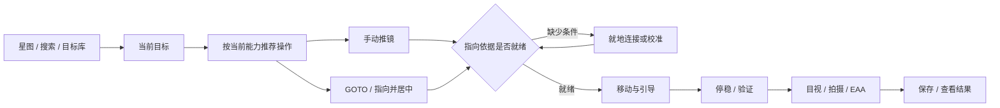

# 观测流程、导航与校准统一设计

> 2026-10-13 初始设计，问题核对基线：`main` / `7485d04`；该次只更新文档。后续实现与验证状态见下方账本，本文保留完整设计和验收要求。
> 本文是 [全应用交互规范](INTERACTION_GUIDELINES.md) 的首批应用实例；交互改造已提升为下一阶段 P0 产品主线。[手机与镜筒指向方案](PHONE_PLATE_SOLVE_PLAN.md)约定坐标与标定；[TODO](../TODO.md) 的 `WF-00`–`WF-12` 跟踪实施。已有代码不等于整条流程已经验收。

第零、第一批结果见 [WF 批次验收](WF_PHASE_0_1_ACCEPTANCE.md)；完整实现、复核缺口及现场证据见 [剩余批次账本](WF_REMAINING_IMPLEMENTATION.md)。四工作区、就地控制、返回/空白关闭和真实标定已接入；真机及新手验收尚未闭合。

## 1. 要解决的问题与改造前证据

| 用户遇到的问题 | 改造前（7485d04）实现线索 | 改造目标 |
|---|---|---|
| 星图、极轴校准、推镜、目标库都像赤道仪的附属功能 | `MountControlScreen` 放置这四个入口；`CameraScreen` 中星图返回写死到 `MOUNT` | 星图承载找目标与指向，极轴校准属于观测准备；无电控架台也能发现推镜 |
| 点顶部滤镜轮/调焦器后跳到器材，又出现整排设备选择 | `CameraScreen.onDeviceClick` 将这类设备统一路由到 `ACCESSORIES`；`AccessoriesScreen` 再显示 `DeviceTab` 分组 | 在原任务上打开对应设备的快捷控制或连接面板 |
| 返回键/系统边缘返回越级，部分路径直接退出 | 壳层混用 `selectedTab`、多个 `show*` 布尔值和 `phoneNav`；星图 `BackHandler` 直接调用页面返回 | 统一返回栈和浮层关闭顺序，返回真实来源 |
| 星图点空白不关闭标签/面板 | 现有自动隐藏、面板互斥和页面返回是分散的逻辑 | 区分空白短按、选星、拖动和系统返回，统一关闭规则 |
| 有手机板解和校准向导，看起来却未形成可靠推镜流程 | 手机解算结果仍直接参与引导；向导含演示残差，未建立镜筒标定关系 | 先明确“测到了谁、校准了什么”，再允许镜筒到位确认 |

以上来自用户反馈与静态源码核对；尚未完成 Android 真机交互复现和新设计验收。主要代码入口：[CameraScreen](../app/src/main/java/com/indigo/mobileobservatory/ui/screens/CameraScreen.kt)、[MountControlScreen](../app/src/main/java/com/indigo/mobileobservatory/ui/screens/MountControlScreen.kt)、[AccessoriesScreen](../app/src/main/java/com/indigo/mobileobservatory/ui/screens/AccessoriesScreen.kt)、[StarMapScreen](../app/src/main/java/com/indigo/mobileobservatory/ui/screens/StarMapScreen.kt)。

## 2. 功能按观测任务组织

保留现有暗色/红光主题、顶部状态带和自适应导航布局；目标一级结构调整为 **星图 / 拍摄 / 影像 / 器材**。这取代上一版暂时保留“相机/赤道仪/星图/器材/工具”五标签的安排，先按规范完成原型和找入口验证再迁移。应用起始页保持“拍摄”（现相机），不另加功能总控首页或独立“手机观测系统”。

| 主入口 | 负责的任务 | 二级入口与边界 |
|---|---|---|
| 星图 | 找天体、看位置、选择目标、手推或电动指向 | 搜索/目标库/今夜推荐共用一个选目标流程；目标卡进入推镜、GOTO 或指向并居中；“观测准备”放置指向校准与极轴校准 |
| 拍摄 | 对焦、拍摄、录像、实时叠加、导星及准备 | 实时叠加顶部切换行星/深空，接收当前目标和光路；最近拍摄缩略图与保存后查看直达影像 |
| 影像 | 找回、查看和处理已有素材 | 最近、照片、录像、叠加结果；导入影像与后期叠加并列，后期顶部切换行星/深空；详情保留解析/导出动作 |
| 器材 | 发现、连接、配置设备及光路 | 设备清单 → 某设备详情；镜筒/目镜/相机关系及支架配置在这里可维护，任务中按需补全 |

赤道仪完整控制归入器材；方向、跟踪等常用控制在星图/状态带就近提供。“工具”不再作为长期一级分类，按 [功能归属表](INTERACTION_GUIDELINES.md) 分配到任务中。迁移期旧快捷入口只转到同一目的地并保留来源；序列继续受发布开关控制。

极轴校准调整架台极轴，手机与镜筒标定建立安装关系，赤道仪同步校正控制器坐标。三者分别命名，不用一个“对齐”按钮混在一起。经纬仪或手动 Dob 的正常推镜不要求极轴校准。

“推镜集成在星图”指同一目标、同一会话和连续的画面/操作层级：在星图选择目标后进入引导覆盖层，返回即恢复原星图。低功耗原生星图和 Stellarium 是可替换的显示方式，共用领域状态；原生路径及不含 Stellarium 资源的构建也必须支持选目标、校准和推镜，不能要求后台常驻 WebView。

## 3. 从目标到观测的一条连续流程

普通 GOTO 只需要对应电动能力，可显示“运动完成”；只有具备合格参考观测，才能显示“光学校验到位”。浏览星图不需要连接器材，粗略手机朝向不能冒充已经校准的镜筒方向。

跨功能共享观测上下文：当前目标及其历元、观测地点和时间、工作光路、可用设备能力、指向来源及有效性、当前任务、返回来源。目标库选中天体后更新这个上下文，不另存一份仅供推镜使用的目标。正在执行的任务固定自身目标和配置版本；用户浏览另一天体只改变候选目标，不能偷偷改写正在运行的 GOTO 或叠加元数据。

连接与算法仍由现有 adapter/module/ViewModel 负责。共享上下文引用这些状态，不复制一套连接状态；明确区分目标选择、任务执行与 UI 路由，避免把所有新功能继续塞进 `CameraScreen` 的独立布尔值。

主界面只显示目标、当前状态和一个推荐主操作。例如“需要校准手机与镜筒 → 开始校准”；展开后才显示其他可行路径、坐标、残差和诊断。自动识别已知设备，只询问无法推断的物理关系，不展示 L1–L5 等内部档位或一屏说明文字。

## 4. 顶部设备状态带与器材页

状态带继续用于一眼查看状态。点一个设备，应立即出现这个设备能做的事，且保留下面的星图、相机或 EAA 工作区。

| 点击对象/状态 | 响应 | 关闭后 |
|---|---|---|
| 已连接的滤镜轮 | 打开当前滤镜、切换及必要状态的快捷面板 | 返回原任务，不改变主导航 |
| 已连接的调焦器 | 打开位置、步长、内外移动及停止 | 返回原任务，设备运动仍按现有控制规则管理 |
| 未连接的设备 | 打开仅针对该设备类型的选择/连接面板 | 连接成功后继续刚才的控制或任务 |
| 相机、架台、导星、制冷等状态 | 同样打开对应摘要/常用控制；“完整控制”可进入相应页面 | 完整控制有真实返回来源 |
| 错误或断线 | 显示该设备的原因和一个恢复操作 | 不强制跳走、不清空目标与已有结果 |

“更多设置/管理器材”才进入完整器材详情。器材根页以设备清单和分组为主体，详情页只保留当前设备标题和返回入口，不再叠加一套覆盖全部设备的第二层 Tab。顶部状态带与页面内容各司其职；不能仅把双排设备按钮缩小后视为完成。

快捷面板与完整详情复用同一控制组件和状态源，不能出现两个独立的滤镜选择或调焦位置。多个同类型设备时准确传递设备身份，无法确定当前设备时才就地选择。关闭面板不等于停止设备；按住运动的控件在手指释放、取消或控件失去交互时必须发送停止，不能留下持续手动移动。

## 5. 返回、浮层与星图手势

### 5.1 统一返回顺序

应用内 Android 系统边缘返回手势（三键导航的返回键也一样）、工具栏返回和可用的预测性返回使用同一导航状态。取消系统返回手势不改变页面；不额外抢占星图中间区域的横向滑动。外部应用跳入遵守平台 Back/Up 的区别，见下表及 [交互规范](INTERACTION_GUIDELINES.md)。

| 当前层级 | 返回行为 |
|---|---|
| 输入法正在输入 | 先按系统规则收起输入法，不退出页面 |
| 弹窗、菜单、设备快捷面板、详情浮层 | 关闭最上层；多层情况下每次只退一层 |
| 校准、视场设置等多步子流程 | 先回到上一步；第一步再返回调用处。仅确有未保存修改时提示保存/放弃 |
| 全屏观测/图像放大模式 | 先回到所属任务的普通视图，保留图像、参数和运行状态 |
| 完整子页面 | 返回实际调用者，例如从星图进入极轴校准就回星图，从工具进入就回工具 |
| 一级工作区根页面 | 一级工作区互为平级，切换不无限压栈；系统返回从非起始页回“拍摄”（现相机），不写死返回赤道仪。根页使用主导航，不放伪上级返回箭头 |
| 应用起始根页面且无浮层/子任务页 | 才将系统返回交给系统离开 Activity；不显示退出用工具栏 Up，不增加每次退出都确认的弹窗 |
| 外部应用打开文件/链接 | 系统 Back 遵循调用任务栈，工具栏 Up 进入本应用的合理父目的地；不强求两者回同一外部应用 |

选择其他一级工作区时，各自保留子流程状态；再次进入可继续。主导航切换与子页面的“返回”不能共用一个随意覆盖 `selectedTab` 的回调。外部文件、快捷入口等直接进入子页时补全合理父目的地，并区分外部调用者与应用内来源。

返回只改变导航或当前编辑步骤，不暗中断开设备、清空标定、重置叠加或改目标。运行中任务的 STOP/暂停/取消是明确操作；切页后的后台生命周期仍遵守已有采集与叠加约定，不承诺未实现的后台持续运行。旋转屏幕保留状态；进程重建恢复可持久化内容后重新验证设备与当前指向，不能恢复成仍在运动或已到位的假状态。

### 5.2 星图画布

| 操作 | 约定 |
|---|---|
| 点天体 | 选中候选目标并打开紧凑卡，收起互斥的观测工具/图层面板 |
| 点空白且有卡片、菜单或面板 | 关闭最上层非模态信息层，保留当前目标与引导任务；同一次点击不再触发下面的动作 |
| 点空白且没有信息层 | 显示此前自动隐藏的常用控件，不重新弹出已关闭的目标卡 |
| 再点同一入口 | 收起已经打开的面板；点另一入口按互斥规则切换 |
| 拖动/双指缩放 | 操作星图；不误判为空白短按。拖动暂停跟随，缩放不强制关闭跟随，坐标轮询不抢镜头 |
| 面板内部点按/滚动 | 不穿透到星图，也不误触发页面返回 |
| 系统返回/工具栏返回 | 有信息层先关闭；再退引导/子页面；最后执行一级根页规则 |

区分“所选目标”和“目标卡可见”两个状态，不能用清空目标实现关闭卡片。“锁定浮层”只禁止空闲自动隐藏，不禁止主动关闭或返回。已关闭的卡片不因坐标更新再次弹出。需要保存的设置页点外部时按其编辑规则处理，不能无声丢失参数。

全局 STOP 的可见性、手动方向键松手停止、运动互斥均保持 [DESIGN_NOTES](DESIGN_NOTES.md) 现有约定。空白点击、超时隐藏、打开设备面板不能遮住运行中必须可达的 STOP。

## 6. 校准也属于同一个任务

开始引导时按“现在有什么、还缺哪条关系”推荐路径，详细模型见 [PHONE_PLATE_SOLVE_PLAN](PHONE_PLATE_SOLVE_PLAN.md)。

| 当前条件 | 推荐引导 | 完成后可用 |
|---|---|---|
| 主镜目镜、手机固定、无电控架台 | 选亮星 → 目镜居中 → 手机拍星野 → 换星验证 | 从手机姿态推算镜筒指向，手动推镜 |
| 主镜有可解析相机、手机固定 | 明确相机所在光路 → 两路配对解算 → 换方向验证 | 自动求手机与镜筒关系；无需先连接架台 |
| 另有可读架台 | 对照独立光学结果，展示回读差值与时间 | 辅助诊断；只有已核实的相对轴读数才可辅助短时跟踪 |
| 架台可 GOTO / SYNC | 在上述路径上按独立能力增加自动采样、同步和指向并居中 | 自动运动与控制器校正分别呈现，不能“已连接”就全启用 |
| 手机支架可调 | 调整后锁紧再标定；不强制同轴 | 非同轴但刚性稳定也能推镜；移动手机后仅失效相关标定 |

校准结果默认用短状态表示：“可推镜”“需重新校准”“暂用估计方向”。点击状态可查看依据、年龄、误差和重校原因。手机镜头、镜筒、参考相机/光路、架台模型各有身份，不能只有一个全局 `calibrated=true`。

## 7. 分批落地与职责

| 批次 | TODO | 交付边界 |
|---|---|---|
| 0：P0 规范与入口原型 | WF-00 | 本规范与全量入口/返回清单，四工作区完整路径原型；按交互规范验收 |
| A1：P0 日常交互 | WF-03/04、WF-02 | 先修返回、星图空白关闭和设备就地控制；不必等手机算法或全部分类迁移 |
| A2：P0 分类和全局复用 | WF-01、WF-12 | 四工作区、目标/结果衔接、复用交互规则并巡检其他页面，旧入口明确迁移 |
| B：使指向有可信依据 | WF-05 → WF-06 → WF-07、WF-09 | 坐标与能力契约、真实校准、到位验证、视场来源；无架台路径必须独立成立 |
| C：增加电动和编码器辅助 | WF-08，依赖 WF-05/06/07 | 按协议能力接入，复用现有运动与精确居中流程；不为不同硬件重造整套界面 |
| 持续验证 | WF-10、WF-11 | 新手和系统手势测试属于每批完成条件；实拍/功耗独立继续，不等持久化索引完成才采数据 |

新导航不把实验性校准当成已可用功能。真实结果写入和独立验证完成前，不展示演示精度、不自动同步架台、不承诺达到 SSE 的实际精度。

## 8. 端到端验收场景

以下均为待验收，后续每次结果记录测试提交、手机/Android 版本、器材、操作和证据；源码字符串检查不能替代手势与任务保持测试。

| 编号 | 场景 | 通过条件 |
|---|---|---|
| UX-01 | 未接赤道仪，从星图找目标并开始推镜 | 不访问赤道仪标签；缺失条件就地补齐，目标不丢失 |
| UX-02 | 星图/EAA 中依次点滤镜轮、调焦器；含未连接及多设备 | 直接打开对应设备，连接/控制后回到原任务；无双排设备总导航 |
| UX-03 | 星图 → 目标库 → 详情、拍摄准备/旧工具快捷入口 → 极轴、星图 → 极轴、校准多步、影像 → 播放器、外部打开文件 | 应用内三键/边缘/工具栏返回每次退一层、来源一致；取消手势无副作用；根页与外部调用的 Back/Up 符合平台约定 |
| UX-04 | 打开目标卡/观测工具/图层，再点空白、面板内、拖动、缩放 | 按上表响应；无点击穿透、关闭后重弹、误 GOTO/SYNC 或拖动退出 |
| UX-05 | 校准/引导中调整配件、切标签、旋转屏幕、断线重连 | 保存可保存的上下文，明确降级/失效，不假恢复运行或到位 |
| UX-06 | 仅手机+目镜；双相机无架台；可读不支持 SYNC；GOTO+SYNC；手机不可锁紧 | 只提供可用操作和适用校准路径；不要求所有器材齐备 |
| UX-07 | 极慢推镜、微调不足 0.8°、冷却期内停手、移动中曝光、失败后 IMU 恰好接近目标 | 正确等待并重拍；没有本次移动后有效校验不得报到位 |
| UX-08 | 导星/主镜切换、无可信坐标、纯构图、手机偏轴或镜面 | 当前框与计划框语义可辨；未标定的手机中心不等于镜筒 |
| UX-09 | 新手从选目标到指向、EAA、保存、找回结果，再返回观测 | 无需寻找 Android 私有目录，无需理解坐标矩阵；现有素材库路径保留 |
| UX-10 | 小屏/横屏/平板、红光、200% 字体、Stellarium 不可用构建、运行中 STOP | 主操作可见可达，原生路径可用，STOP 不被浮层隐藏 |
| UX-11 | 新手首次找推镜、配件控制、极轴校准、已拍录像和后处理 | 按四工作区归属找到入口；记录首次选择/绕行/求助，不预先讲解页面位置 |
| UX-12 | 设备已连接时开控制、条件就绪时启动引导、保存后查看、之后找回素材 | 满足交互规范中的路径预算；不省掉必要确认/校准，不通过隐藏能力换取少点击 |
| UX-13 | 空影像库、未连接、任务忙、失败重试、能力变化、关闭编辑、全屏返回 | 每种状态有清楚摘要和恢复/继续动作；无只有灰按钮的死路，参数不丢失、操作不穿透 |

验收记录同时统计完成率、误入页面/意外退出次数、返回是否可预期、任务状态丢失和求助点。新手文案通过实际操作验证，不以增加大段说明替代修复入口与层级。
