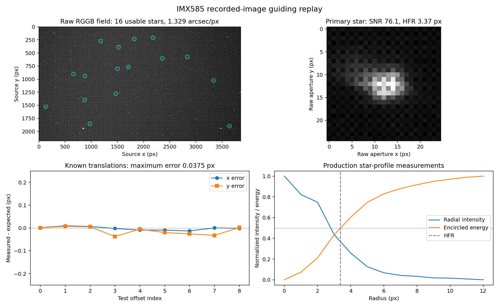
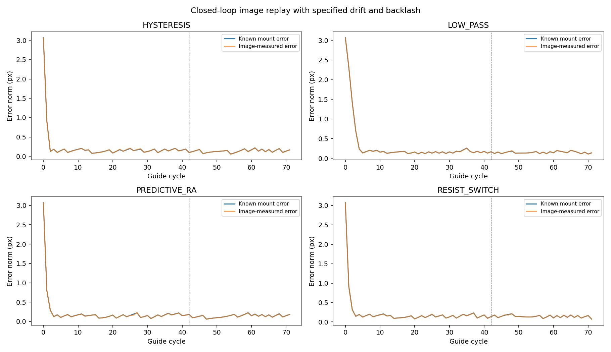

# IMX585 实拍图像导星回放（2026-10-25）

## 输入与复现

输入为用户提供的 `2026-10-25-2004-IMX585.fits`，3856 × 2180、8 bit、RGGB，曝光 5 s、增益 264、像元 2.9 μm、头信息焦距 450 mm。像素尺由这些头信息计算为 1.329262″/px。源文件始终只读，SHA-256 为 `56e0ace11e507302f24df80e36e5690b6a973e6c389dd0d12556ad2035e0e88b`。

```powershell
.\scripts\Test-GuideFitsReplay.ps1 -FitsPath '<原始 FITS 的绝对路径>'
```

脚本运行生产 Kotlin 算法的 JVM 回放，再由 Python 读取结果绘图。Gradle 追踪 FITS 文件输入，切换原始全幅和内置裁切样本会重新执行测试。复现绘图需要 numpy、astropy、matplotlib。

便携测试样本为原图 (656, 788) 起点的 1024 × 768 无损原始裁切，保留 CFA 相位、饱和星、边界星、真实噪声和背景。gzip 约 361 KiB，包含来源与原始像素校验和；默认 JVM 回归无需本机 E 盘文件。说明见 [fixture README](../../../app/src/test/resources/guide/README.md)。

## 发现并修复

1. **饱和检查只读取候选峰值所在单个像素。** 饱和星附近的次峰可绕过筛选，完整原图检出的前四个星像均含 255 ADU 核心。改为检查整个质心测量孔径；饱和峰周围的次峰同样被拒绝。
2. **边缘星像测量窗口被截断。** 原图及裁切中的不完整星像仍可进入导星列表。现在候选及重心都必须容纳完整 25 × 25 诊断窗口。
3. **Bayer 背景只取固定 8 像素间隔，始终采到单一相位。** 原始四相位背景中位数为 24、30、30、19 ADU。按该背景构造的无星噪声场能够产生虚假候选。现在逐相位估计均值、噪声及检测阈值，并比较扣背景信号。
4. **HFR 与流量使用统一背景。** 对同一高斯星仅添加不同 CFA 背景偏置，HFR 会由 2.236 px 变为 3.606 px。现在从外环分别估计四个相位背景，扣除后计算流量、环带强度、包围能量与 HFR；该回归要求流量及 HFR 与统一背景参考一致。

上述操作直接读取原始像素，不执行去马赛克。检测/匹配、校准、星点分析、滤波/死区/限幅/方向/回差策略和脉冲任务均复用生产实现。`GuideModule.solveCorrection` 由实际 ViewModel 与测试共同调用，防止测试中的修正公式与应用分离。

## 全幅回放结果

| 指标 | 结果 |
|---|---:|
| 可用候选 | 16（检测上限；闭环最多使用 12 个参考星） |
| 主星 SNR / 峰值 / HFR | 76.14 / 223 ADU / 3.367 px |
| 9 组整数与亚像素平移，最大测量误差 | 0.03745 px |
| 平移误差 RMS | 0.02143 px |
| 修复前最大平移误差 | 0.57451 px |
| 两轴正式校准步数 | RA 7、DEC 7，均达到至少 15 px |
| 校准拟合残差 | 0.01990 px |
| 设定 RA / DEC 回差 | 600 / 1800 ms |
| 恢复 RA / DEC 回差 | 595 / 1806 ms |

虚拟架台的两轴正交、旋转 30°，设定速度分别为 0.004 / 0.006 px/ms。回差、轴方向和速度均为测试输入；单张 FITS 无法测得实际架台的这些量。平移由每个 CFA 相位平面各自在其采样网格上双线性插值，保持传感器排列固定。无循环卷回，边缘使用对应相位的背景填充。



四种算法各运行 72 轮，图像加入已知持续漂移和周期扰动，使用新测量结果计算、执行修正。下表使用独立虚拟架台记录的真实位置误差计算最后 30 轮 RMS。

| 算法 | RMS（px） | 按头信息换算（″） |
|---|---:|---:|
| Hysteresis | 0.14087 | 0.18725 |
| Low Pass | 0.15070 | 0.20032 |
| Predictive RA | 0.14762 | 0.19622 |
| Resist Switch | 0.14569 | 0.19366 |



测量曲线与真实位置曲线吻合；测试同时要求 RMS 小于 0.5 px，并下降到相同输入漂移无修正时 RMS 的 20% 以下。其他用例覆盖无星 Bayer 背景、饱和/边缘拒绝、丢星后的空匹配、正在发送的脉冲取消与后续 DEC 指令禁止、死区、限幅和反向开关。

机器可读结果为 [summary.json](summary.json)，全部图表的输入 CSV 与本记录一起保存。原始数据、插值帧和候选 APK 均保留在本地；本记录不执行硬件运动。

## 验证边界

这是同一实拍源图与指定动力学条件的确定性回放。插值会改变采样并一同移动记录噪声；真实独立噪声、云层、视宁度、曝光积分期间的运动、SDK 读出/延迟、机械方向不对称与 USB 中断仍需现场验证。表中角秒 RMS 只反映本次回放，不作为真机精度承诺。

最终验证：1145 项 JVM 测试全部通过，0 失败、0 错误、0 跳过；Android 测试源码编译通过；Lint 0 errors、297 warnings。完整原始 FITS 的图像回放与报告脚本通过。Android 实际界面和设备用例继续保留为待验收。
